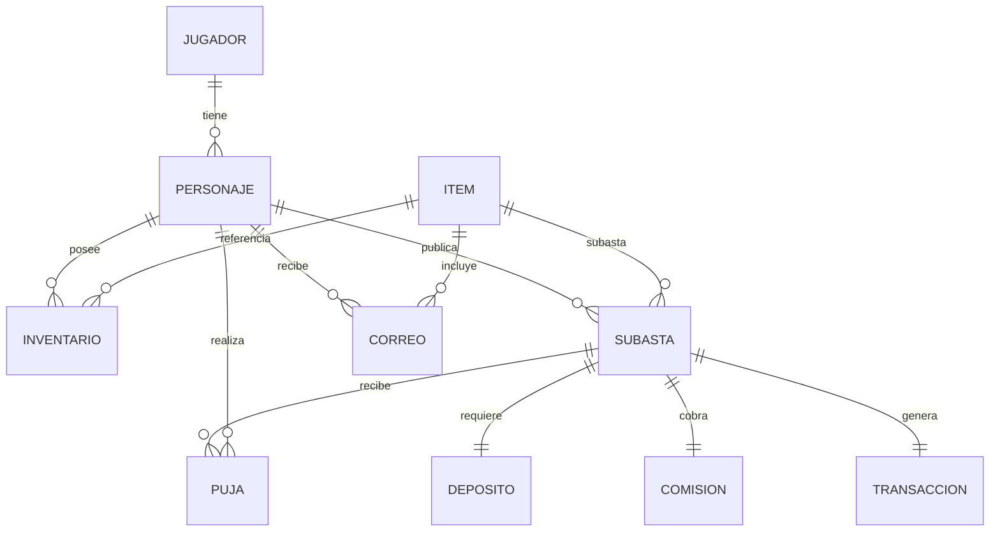

# Modelo conceptual — Subastas WoW

El diagrama editable está en `docs/modelo_subastas_2.1.drawio`
(página **modelo conceptual subastas**). Esta es la versión de lectura rápida.

## Entidades y atributos

| Entidad | Atributos principales |
|---|---|
| JUGADOR | id_jugador, nombre, email |
| PERSONAJE | id_personaje, nombre, nivel, clase, oro |
| ITEM | id_item, nombre, rareza, nivel_requerido, precio_base |
| INVENTARIO | id_inventario, cantidad |
| SUBASTA | id_subasta, cantidad, precio_salida, precio_compra_directa, duracion_horas, estado, fecha_inicio, fecha_fin |
| PUJA | id_puja, monto, fecha, estado |
| DEPOSITO | id_deposito, monto, pagado, fecha |
| COMISION | id_comision, porcentaje, monto, fecha |
| TRANSACCION | id_transaccion, monto, tipo, fecha |
| CORREO | id_correo, asunto, cantidad, oro, estado, fecha |

> El oro pertenece a PERSONAJE, no a JUGADOR. El modelo lógico agrega
> `jugador.fecha_registro` y las claves foráneas correspondientes.

## Relaciones

## Cardinalidades

| Relación | Cardinalidad | Lectura |
|---|---|---|
| JUGADOR — PERSONAJE | 1:N | Un jugador tiene muchos personajes. |
| PERSONAJE — INVENTARIO | 1:N | Un personaje posee muchos registros de inventario. |
| ITEM — INVENTARIO | 1:N | Un ítem puede estar en muchos inventarios. |
| PERSONAJE — SUBASTA | 1:N | Un personaje publica muchas subastas. |
| ITEM — SUBASTA | 1:N | Un ítem puede subastarse muchas veces. |
| SUBASTA — PUJA | 1:N | Una subasta recibe muchas pujas. |
| PERSONAJE — PUJA | 1:N | Un personaje realiza muchas pujas. |
| SUBASTA — DEPOSITO | 1:1 | Cada subasta tiene un depósito. |
| SUBASTA — COMISION | 1:1 | Cada subasta vendida genera una comisión. |
| SUBASTA — TRANSACCION | 1:1 | Cada subasta vendida genera una transacción. |
| PERSONAJE — CORREO | 1:N | Un personaje recibe muchos correos. |
| ITEM — CORREO | 1:N | Un correo puede incluir un ítem. |

> Nota: `DEPOSITO`, `COMISION` y `TRANSACCION` son entidades débiles/de soporte:
> dependen de `SUBASTA` y se crean en momentos concretos del ciclo de vida.
