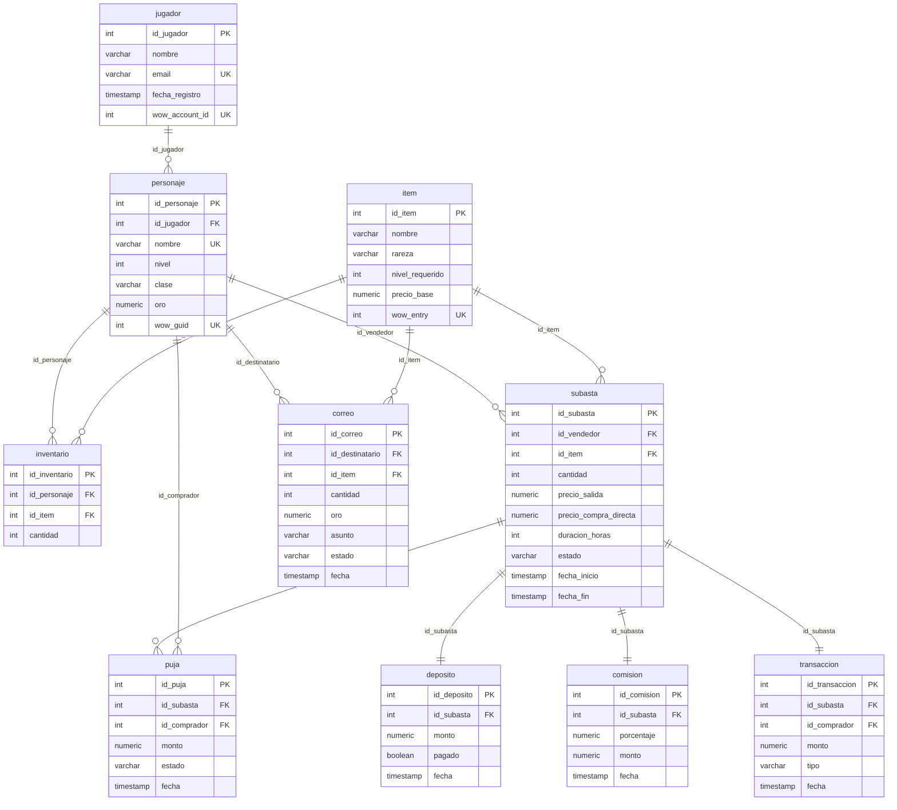

# Modelo lógico — Subastas WoW

El diagrama editable está en `docs/modelo_subastas_2.1.drawio`
(página **modelo logico subastas**). El DDL completo está en `init.sql` y en
`sql/01_schema.sql`.

## Tablas



## Restricciones principales

| Tabla | Restricción |
|---|---|
| `jugador` | `email` UNIQUE; `fecha_registro` NOT NULL DEFAULT now(); `wow_account_id` UNIQUE (NULL permitido). |
| `personaje` | FK `id_jugador` ON DELETE CASCADE; `nombre` UNIQUE; `nivel >= 1`; `oro >= 0`; `wow_guid` UNIQUE (NULL permitido). |
| `item` | `nombre VARCHAR(100)`; `wow_entry` UNIQUE (NULL permitido). |
| `inventario` | FK `id_personaje`, FK `id_item`; `(id_personaje, id_item)` UNIQUE; `cantidad > 0`. |
| `subasta` | `duracion_horas IN (2,8,24)`; `estado IN ('activa','vendida','expirada','cancelada')`; FK `id_vendedor`, FK `id_item`; `precio_salida > 0` (validado en aplicación). |
| `puja` | FK `id_subasta`, FK `id_comprador`; `estado IN ('activa','superada','ganadora')`; `monto > 0` (validado en aplicación). |
| `deposito` | `id_subasta` UNIQUE (1:1). |
| `comision` | `id_subasta` UNIQUE (1:1). |
| `transaccion` | `id_subasta` UNIQUE (1:1); FK `id_comprador`; `tipo IN ('puja_ganadora','compra_directa')`; el vendedor se deduce de `subasta`. |
| `correo` | FK `id_destinatario`, FK `id_item` ON DELETE SET NULL; `estado IN ('pendiente','leido','cobrado','devuelto')`. |

> `wow_account_id`, `wow_guid` y `wow_entry` son columnas técnicas de la
> integración de solo lectura con AzerothCore. No forman parte del modelo
> lógico 2.1; se documentan en `sql/03_integracion_wow.sql`.

## Índices recomendados

```sql
CREATE INDEX idx_personaje_jugador ON personaje(id_jugador);
CREATE INDEX idx_inventario_personaje ON inventario(id_personaje);
CREATE INDEX idx_subasta_estado ON subasta(estado);
CREATE INDEX idx_subasta_fin ON subasta(fecha_fin);
CREATE INDEX idx_puja_subasta ON puja(id_subasta);
CREATE INDEX idx_puja_comprador ON puja(id_comprador);
CREATE INDEX idx_correo_destinatario ON correo(id_destinatario);

-- Claves externas de AzerothCore (integración de solo lectura)
CREATE UNIQUE INDEX uq_jugador_wow_account ON jugador(wow_account_id);
CREATE UNIQUE INDEX uq_personaje_wow_guid ON personaje(wow_guid);
CREATE UNIQUE INDEX uq_item_wow_entry ON item(wow_entry);
CREATE UNIQUE INDEX uq_inventario_personaje_item ON inventario(id_personaje, id_item);
```
